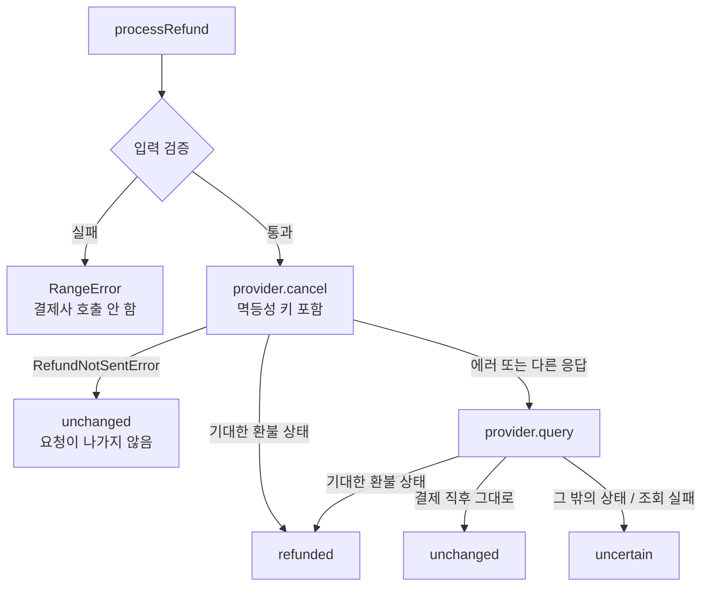

# 환불 정책과 복구 판단 기준

## 1. 시간 구간별 환불

남은 시간 = `startsAt - now`

```
           0          noRefundHours        fullRefundHours
───────────┼─────────────────┼─────────────────────┼────────────▶ 남은 시간
 취소 불가  │   환불 0원       │   partialRefundRate% │  전액 환불
session_   │ imminent_        │ late_cancellation_   │ standard_
started    │ cancellation_    │ partial_refund       │ full_refund
           │ no_refund        │                      │
```

경계는 다음과 같이 포함됩니다. 기본 정책(24 / 50 / 2) 기준 예시입니다.

| 남은 시간 | 결과 | 이유 |
| --- | --- | --- |
| 24시간 + 1ms | 100% | 24시간 이상 |
| 정확히 24시간 | 100% | 전액 환불 경계는 **포함** |
| 24시간 − 1ms | 50% | |
| 2시간 + 1ms | 50% | |
| 정확히 2시간 | 0원 | 환불 불가 경계는 **포함** |
| 1ms | 0원, 취소 가능 | |
| 0 | 취소 불가 | 시작 시각이 되면 시작한 것으로 봄 |

### 금액 계산

- 부분 환불은 `Math.floor(금액 × 비율 / 100)`으로 원 단위 내림합니다.
- 남는 금액은 모두 취소 수수료입니다. `환불액 + 수수료 = 결제 금액`이 항상 성립합니다.
  - 예: 24,501원의 50% → 환불 12,250원, 수수료 12,251원

### 정책 검증

`assertValidRefundPolicy`는 아래 경우 `RangeError`를 던집니다. `calculateRefundQuote`도 계산 전에 호출합니다.

- `noRefundHours`가 음수
- `noRefundHours ≥ fullRefundHours` (부분 환불 구간이 없어지거나 뒤집힘)
- `partialRefundRate`가 0~100 정수가 아님
- 시간이 유한한 숫자가 아님

## 2. 환불 응답이 끊겼을 때



### "기대한 환불 상태"

| 필드 | 조건 |
| --- | --- |
| `paymentKey` | 요청한 결제 키와 같음 |
| `totalAmount` | 원래 결제 금액과 같음 |
| `balanceAmount` | 결제 금액 − 환불 금액 |
| `status` | 전액이면 `CANCELED`, 부분이면 `PARTIAL_CANCELED` |

### "결제 직후 그대로"

같은 결제 키·총액에 `balanceAmount === totalAmount`, `status === "DONE"`.

### 호출한 쪽이 할 일

| 결과 | DB 처리 | 재시도 |
| --- | --- | --- |
| `refunded` | 환불 완료로 마무리 | 필요 없음 |
| `unchanged` | 결제 상태를 원래대로 되돌림 | 가능 (같은 멱등성 키 사용) |
| `uncertain` | 환불 진행 상태 유지 (`reconcile_required` 등) | **하지 않음.** 운영자가 결제사 콘솔에서 확인 |

`uncertain`을 `unchanged`처럼 처리하면 이중 환불이 생길 수 있습니다. 판단할 수 없으면 사람이 확인할 때까지 멈추는 것이 이 로직의 목적입니다.
